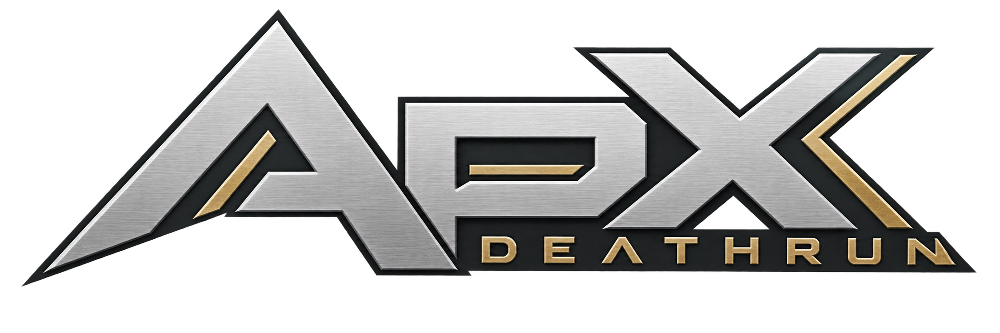

<div align="center">



**Run. Adapt. Repeat.**

A progression-driven Deathrun mod for Call of Duty 4, built on BraXi's Death Run.

[Start here](docs/GETTING-STARTED.md) · [Documentation](docs/README.md) · [Tooling](docs/TOOLING.md) · [Build & test](docs/TESTING.md)

**70 levels** / **5 prestiges** / **50 prestige milestones** / **Official CoD4x client**

</div>

---

## Project

A lot of this project is not done, there's plenty of bugs, plenty of untouched stuff, so.... yuh.

# AI DISCLAIMER

literally like 95% of the UI is AI lol. dont hate on me because i dont want to work with CoD4 UI. i obviously touched a lot of the UI code where there needed to be functionality, but everything you see design wise was the great mind of Sol 6.1.

ALL documentation is generated by AI, i cba. If something is wrong, or you see a discrepency from code -> docs, please let me know.

Tests are mostly written by AI, i established the framework and let sol go nuts on validations, as one does.

The BIGGEST noticeable AI thing is that god awful main menu background, dont hate ik its slop lol.

# STORAGE DISCLAIMER

**THIS REPO IS 3GB**. It ain't small by no means. There's a lot of assets, we're pushing the 2048 asset limit with this mod. So, just a fair warning. See the docs folder to learn how this repo is structured and all the scripts and yada yada.

## The mod

One Activator. A course full of traps. Everyone else trying to make it through.

ApX adds persistent progression, a large curated content collection, and a custom
interface to the original Deathrun loop. Practice stays active until the server
has enough players for a round.

| Progression                              | Equipment                                 | Interface                                     |
| ---------------------------------------- | ----------------------------------------- | --------------------------------------------- |
| 70 levels and 5 prestiges                | 22 pistols, 2 snipers and 9 melee choices          | Dedicated loadout and catalog menus           |
| Ten rank-gated rewards per prestige      | 36 recognizable operators                       | Actual-model stills and optional turntables   |
| Lifetime stats, challenges and abilities | 5 arms sets, plus automatic operator arms | Compact HUD, smooth XP and custom scoreboard  |
| Admin XP, rank, prestige and full reset  | Primary + knife carried as secondary      | Saved FOV, Fullbright and display preferences |

The full imported asset library is retained here. The
[active profile](ui/content_profile.json) deliberately enables a smaller collection
that fits the official client's limits. Expanding server pools alone cannot
remove client weapon/material limits.

## Build locally

You need a licensed Windows CoD4 installation with **CoD4 Mod Tools**, PowerShell
5.1 or newer, Git, and Git LFS. Normal mod builds do not require Python or Blender.

Place the checkout at `Call of Duty 4/Mods/apx_dr`, then run:

```powershell
git lfs install
git lfs pull
git lfs fsck
.\tools\build.ps1 -Target Check
.\tools\build.ps1
```

Outputs go to `dist/`: `mod.ff`, `apx_dr.iwd`, `apx_dr_sounds.iwd`, and loose server
configuration. Use the matching [ApX server](server/README.md) with the official
CoD4x client. [Getting started](docs/GETTING-STARTED.md) covers installation,
private configuration and launch commands.

**This is a full asset repository.** Expect roughly 3 GB of art and engine files,
plus Git/LFS storage. Install Git LFS before cloning; a source ZIP is not a reliable
substitute for a hydrated checkout.

## Work on it

```powershell
python -m pip install -r requirements-dev.txt
python tools/check.py                 # SDK-free checks; no LFS fetch required
python tools/check.py --suite full    # hydrated assets + installed SDK
.\tools\test-build.ps1                # SDK-free Windows build transaction tests
```

Native server suites and human-client checks are documented separately. Python
tests exercise script decisions and assets; they do not emulate the game.

| I want to…                                 | Read                                                                               |
| -------------------------------------------- | ---------------------------------------------------------------------------------- |
| Install, configure and run a server          | [Getting started](docs/GETTING-STARTED.md)                                         |
| Deploy the public server through Teleport          | [Public deployment](docs/DEPLOYMENT.md)                                           |
| Understand every tool and its inputs/outputs | [Tool reference](docs/TOOLING.md)                                                  |
| Change content, unlocks or model previews    | [Content workflow](docs/CONTENT-WORKFLOW.md)                                       |
| Work on menus, HUD or shaders                | [Menus](docs/MENUS.md), [interface](docs/INTERFACE.md), [shaders](docs/SHADERS.md) |
| Test progression and admin commands          | [Progression](docs/PROGRESSION.md), [administration](docs/ADMINISTRATION.md)       |
| Diagnose asset limits or a build failure     | [Troubleshooting](docs/TROUBLESHOOTING.md)                                         |
| Prepare a public release                     | [Release checklist](docs/RELEASING.md), [licensing](docs/LICENSING.md)             |

## Repository map

```text
src/          GSC, native menus, tables, weapon definitions and localization
assets/       Binary engine assets and sounds                         [LFS]
art/          Editable artwork and actual-model preview renders       [PNG: LFS]
ui/           Catalog, active profile, preview and texture registries
manifests/    Ordered fastfile asset declarations
config/       Public server defaults and private-config example
tools/        Build, authoring, import and verification tools
tests/        Python decision/asset tests and native GSC fixtures
server/       Patched CoD4x server, patch and corresponding source     [binaries: LFS]
docs/         Setup, architecture, workflows and reference
```

`build/`, `dist/`, downloads, recovery snapshots and operator secrets stay local.

## Credits and permission

Original ApX work is **all rights reserved; written permission is required**.
This does not override upstream licenses or grant rights to imported assets.
See [LICENSE.md](LICENSE.md) and [the rights inventory](docs/LICENSING.md).

BraXi's original credits are preserved in [DeathRun_ReadMe.txt](src/DeathRun_ReadMe.txt).
Community provenance is recorded in [content credits](docs/CONTENT_CREDITS.md) and
[the import catalog](ui/content_catalog.json). The modified server retains its
[AGPL license](server/LICENSE.md) and corresponding source.

**Publication status:** repository packaging is prepared; third-party
redistribution permissions still require review before a public upload.
